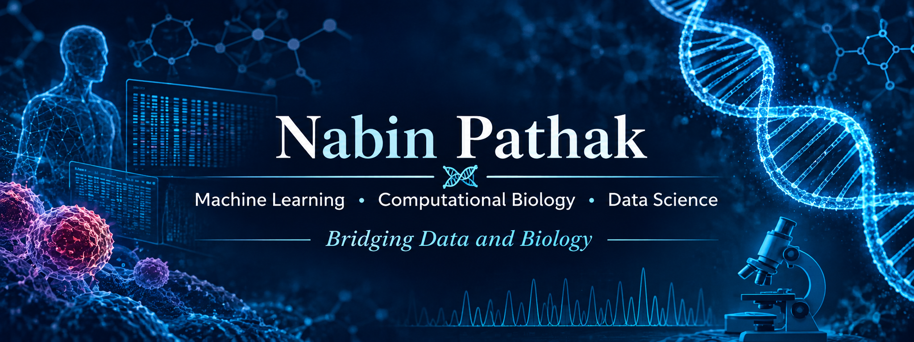

  

## Tech Stack

  
  
  
  
  
  
  
  
  
  
  

I work at the intersection of machine learning, multimodal learning, and computational biology. My current independent research explores computational approaches to multi-cancer early detection using cell-free DNA (cfDNA) methylation data.

[LinkedIn](https://www.linkedin.com/in/er-nabin-pathak-a29179237/) · [Google Scholar](https://scholar.google.com/citations?user=upqTrbQAAAAJ&hl=en) · [Email](mailto:nabinpathak520@gmail.com)

---

## GitHub Statistics

  
  

  

## Research interests

- Machine learning and statistical learning
- Computational genomics and bioinformatics
- cfDNA methylation and liquid-biopsy analysis
- Multimodal representation learning
- Biomedical data science

## Selected research projects

### [MCED — Liquid Biopsy Intelligence](https://github.com/Nabinpathak/MCED-Liquid-Biopsy-Intelligence)

**Independent computational research · Ongoing**

Exploring cfDNA methylation signals for multi-cancer early detection.

- Processing CpG-level methylation data and genomic coordinates.
- Developing coverage-aware methylation features and chromosome-level summaries.
- Evaluating exploratory machine-learning approaches, including XGBoost.
- Investigating genomic-distance measures as preliminary fragmentation-related proxies.

**Current scope:** This is an exploratory research project, not a clinically validated diagnostic system. The initial experiments are limited in sample size and require rigorous validation on larger, independent cohorts. Integrating methylation with somatic mutation and true cfDNA fragmentomic features is a future research direction.

### [Multimodal Speech Recognition](https://github.com/Nabinpathak/multimodal_speech_recognization)

**Undergraduate research project**

Explored audio-visual speech recognition by combining acoustic and visual information using deep-learning architectures.

- Worked with audio-visual speech recognition datasets and model pipelines.
- Explored an Efficient Conformer-based audio pathway and a ResNet-18 visual pathway.
- Studied multimodal feature integration and robustness under noisy conditions.

---

## Publications

- **Ethical Considerations in Speech Recognition Using Deep Neural Network: A Systematic Review** (2024). [SSRN](https://papers.ssrn.com/sol3/papers.cfm?abstract_id=4937978)
- **Multi-modal Speech Recognition: Integrating Audio and Visual Information with Deep Neural Network** (2024). Publication details and manuscript available through the [speech-recognition project repository](https://github.com/Nabinpathak/multimodal_speech_recognization).

## Professional experience

**Data Analyst — Nepa Wholesale USA**

Working with business data, database workflows, reporting, and operational systems.

## Education

**B.Tech in Computer Science and Engineering**  
Sharda University, India

---

I am interested in research opportunities and collaborations in machine learning, computational genomics, and biomedical data science.

